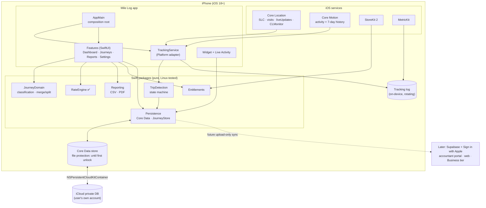

# 1. Architecture proposal and technology stack

## 1.1 Guiding constraints

1. **Tracking reliability decides whether the product exists.** Everything else is ordinary app work. The architecture puts the tracking engine in its own package so it can be frozen, measured and replaced without touching the rest.
2. **Local-first.** A journey is recorded, stored, classified, calculated and exported with no network. A backend, when it comes, is an optional sync target, never the system of record for a trip in progress.
3. **Business rules stay out of SwiftUI.** Rate engine, tracking state machine, classification rules and export formats are plain Swift packages with no UIKit/SwiftUI imports, testable on Linux CI.
4. **Few dependencies.** Each third-party SDK is a privacy disclosure, a supply-chain risk and an upgrade cost.

## 1.2 Recommended stack, with alternatives

| Concern | Spec proposal | Recommendation | Why / trade-off |
|---|---|---|---|
| Language | Swift 6 | **Swift 6, strict concurrency on in new packages.** RateEngine stays Swift 5 mode until its first green run, then flips. | Data-race safety matters most in the tracking engine, where CLLocationManager callbacks, background relaunch and persistence interleave. |
| UI | SwiftUI, MVVM | **SwiftUI with `@Observable` view models, one per screen, thin.** | `@Observable` (iOS 17+) removes most Combine plumbing. "Massive view model" risk is handled by pushing logic into packages, not by adding layers (no coordinators/VIPER). |
| Minimum iOS | "select during planning" | **iOS 18** (council D1), with iOS 26 features behind `#available` checks. | `CLServiceSession` is new in iOS 18. `CLMonitor`, `CLLocationUpdate` and `CLBackgroundActivitySession` arrived in iOS 17. So iOS 18's tracking advantage over iOS 17 is narrow: mainly `CLServiceSession`, plus the iOS 18 fixes to the iOS 17 APIs. The classic `CLLocationManager` baseline (§3.2) works on both. Tradespeople keep their phones longer. How many more people iOS 17 would reach is unknown **(verify with adoption data at launch)**. |
| Persistence | SwiftData "or another" | **Core Data** (council D6). | Core Data's migration tooling is mature for local data. It supports separate configurations, so GPS points stay on the phone while other records sync (§2.2). Background contexts let the tracker write without touching the main thread. Developers have reported SwiftData migration and CloudKit problems **(verify against current release notes)**. Caveats: once the iCloud schema is in production it can only be added to, in either framework, and Core Data needs more code. It sits behind a `JourneyStore` protocol, so a later move is contained. |
| Sync | Supabase | **v1: iCloud private database via `NSPersistentCloudKitContainer`. Supabase deferred until a feature needs a server** (accountant portal, web dashboard, Business tier). | See 1.4 — the largest disagreement with the spec. |
| Auth | Supabase Auth | **None in v1.** Sign in with Apple when a backend arrives. | No account = no password reset, no credential storage, no account-takeover surface, faster onboarding, and a marketing line ("No account. Your data stays on your phone and in your own iCloud"). |
| Payments | RevenueCat | **StoreKit 2 directly in v1.** RevenueCat when a second platform (web) needs entitlements. | One platform, two products, no server: StoreKit 2's `Transaction.currentEntitlements` covers it with zero dependencies and no third-party data sharing. RevenueCat's value (cross-platform entitlement sync, dashboards, paywall experiments) arrives with the backend. Its free allowance for small apps **(verify current pricing)** makes switching later cheap. |
| Maps | MapKit | **MapKit** for showing routes, the reverse geocoder (`CLGeocoder`, or MapKit's newer geocoding API on iOS 26 **(verify which to use)**) with cached, coarse results (street and town), and `MKDirections` for estimated distances. | No third-party map SDK. |
| Tests | Swift Testing | **Swift Testing for new packages; XCTest kept where it exists and for UI tests.** | Both run in one `swift test`. Rewriting RateEngine's tests buys nothing. |
| Analytics | unspecified | **TelemetryDeck** (privacy-first, EU-hosted, no IDFA) *or* Apple's App Analytics + MetricKit only. Decide in phase 8. | Avoid Firebase/Mixpanel: they undercut the privacy positioning and need ATT-style disclosures. |
| Crash/diagnostics | unspecified | **MetricKit** (crash, hang, battery, location-energy diagnostics) + on-device tracking log with user-initiated export. | MetricKit gives the battery numbers council D5 needs, for free. |
| CI | GitHub Actions | **GitHub Actions: Linux job for pure packages (fast, free), macOS job for the app target (Xcode build + unit tests on simulator).** | macOS minutes cost 10× Linux; keep most tests in Linux-runnable packages. |

## 1.3 Module layout

The spec's module list is right in substance; the change is **which modules are Swift packages** (pure, Linux-testable) and which live in the app target.

```
Antonio/
├─ MileLog.xcodeproj               (app target, widget, Live Activity)
├─ App/                             app target sources
│  ├─ AppMain/                      lifecycle, composition root (DI), navigation
│  ├─ Features/
│  │  ├─ Onboarding/
│  │  ├─ Dashboard/
│  │  ├─ Journeys/                  list, detail, edit, classify, manual add
│  │  ├─ Reports/
│  │  └─ Settings/                  vehicles, year end, places, rules, privacy
│  ├─ DesignSystem/                 tokens, components
│  └─ Platform/                     CoreLocation/CoreMotion adapters, StoreKit, CloudKit, MetricKit
└─ Packages/
   ├─ RateEngine/          ✅ built  rates file + trips → claim (pure)
   ├─ TripDetection/                state machine: samples/events in → trip segments out (pure)
   ├─ JourneyDomain/                Journey, Vehicle, Place, Rule models; classification rules; merge/split (pure)
   ├─ Persistence/                  Core Data stack, JourneyStore, migrations, dedupe
   ├─ Reporting/                    CSV (FreeAgent, generic), PDF summary (pure except PDF render)
   └─ Entitlements/                 free/pro feature map; StoreKit adapter lives in app Platform/
```

**Shared store:** the Core Data store lives in an App Group container from the first build, so the widget, Live Activity and App Intents share it. Only the app process runs CloudKit mirroring. Extensions open the store without the CloudKit option, read-only where they can **(verify)** (§2.2).

**Dependency rule:** `Features → (JourneyDomain, RateEngine, Reporting, Entitlements) → nothing`; `Platform` adapters implement protocols declared in packages. Only `AppMain` knows concrete types (manual constructor injection; no DI framework).

**Not separate modules in v1:** Authentication, Networking, Analytics. Each becomes a package when the backend or analytics lands; carving them out now would be empty abstraction.

## 1.4 Challenge: backend and accounts in the MVP

The spec puts Supabase, Supabase Auth and RLS in the MVP (acceptance criteria 1 and 10). The council plan says *no account, no server* and makes that a selling point. Recommendation: **keep v1 local-first; design the seams so a backend slots in later.**

| | Local-first v1 (recommended) | Supabase in v1 (spec) |
|---|---|---|
| Time to launch | Fits the mid-Feb to mid-Mar 2027 window (§6.4) | Adds auth, schema, RLS, sync, conflict handling, account deletion: ~4–6 weeks |
| GDPR | You process almost nothing: data is on the device and in the user's own iCloud | You become controller of continuous location history: DPIA, retention enforcement server-side, breach exposure, sub-processor list |
| Running cost | £0 | Free tier, then $25/month+ before revenue |
| Onboarding | No sign-up (plan: setup < 2 minutes) | Registration step before first trip |
| Offline / conflicts | CloudKit handles multi-device merges; single-writer per device | Must build retry, idempotency and conflict resolution |
| What it can't do | Accountant portal, web dashboard, multi-driver | All of those |

**Seams that keep the door open:** UUID primary keys generated on device; `createdAt/updatedAt/deletedAt` (soft delete) on every entity; a `syncState` field unused in v1; export formats versioned; all writes through `JourneyStore`. When the accountant portal is validated, add Supabase as a *second* sync target (upload-only from device to start) behind Sign in with Apple — no rewrite.

If you want accounts in v1 anyway (e.g. to build an email list), the cheaper middle path is Sign in with Apple + Supabase for *identity and entitlements only*, with journeys staying local.

## 1.5 System architecture diagram


