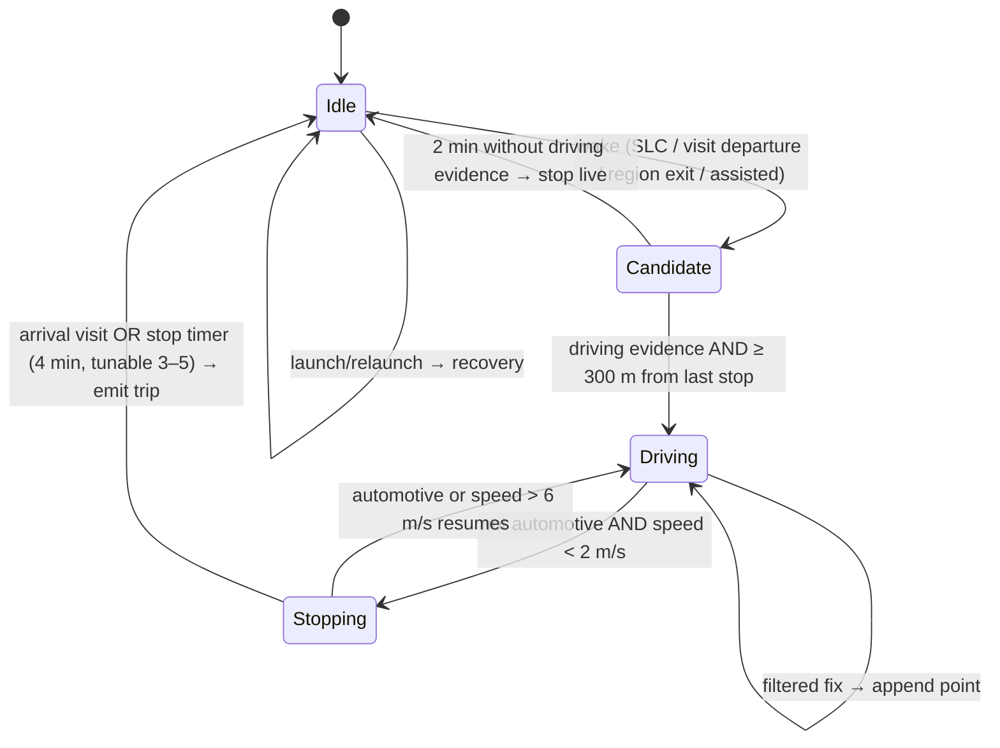

# 3. Core Location tracking strategy, background execution and battery

**How to read the markers:**
- **(verify)**: Apple doesn't document this clearly, or it has changed between iOS versions. It is checked on real phones in Phase 1a or the detection test run before anything depends on it.
- **(estimate)**: a planning figure with no authoritative source, to be replaced by measurements.

No tracking claim rests on simulator testing.

## 3.1 Strategy in one paragraph

A cheap wake layer runs all the time: significant-location-change (SLC) plus visit monitoring. iOS keeps it running even when Mile Log is suspended or terminated. When it wakes the app, the app immediately starts GPS, because that is what keeps it running beyond the short wake window. It then confirms within a couple of minutes that this is a drive. If it isn't, GPS stops. If it is, GPS stays on for the length of the trip and stops shortly after arrival. Drives the app missed are rebuilt afterwards from Core Motion's 7-day activity history and from visits. They are shown as *recovered* and are never counted until the user confirms them. This is council decisions D2 and D3, with the API details corrected.

Continuous high-accuracy GPS all day is ruled out. It costs roughly 10% or more of the battery per hour **(estimate)**, and iOS suspends or kills it regardless.

## 3.2 Which API does what

The two generations of Core Location API are not mixed within a layer.

| Layer | API (iOS 18) | Runs | Role |
|---|---|---|---|
| Wake: SLC | `CLLocationManager.startMonitoringSignificantLocationChanges()` | always (needs Always) | relaunches or wakes the app after roughly 500 m of movement; latency typically a few minutes **(verify; measured in week 1)** |
| Wake: visits | `CLLocationManager.startMonitoringVisits()` | always | arrival and departure events; departures can arrive late **(verify)**, so their time is a hint, not the trip start |
| Wake: last-stop region | `CLMonitor` circle of about 150 m around the last stop | A/B tested (D2) | possibly a faster wake on departure; kept only if it beats SLC, given reports of missed CLMonitor events on iOS 18 **(verify)** |
| Live (prototype baseline) | **`CLLocationManager.startUpdatingLocation()`**: `activityType = .automotiveNavigation`, `desiredAccuracy = kCLLocationAccuracyBest`, `distanceFilter = 10` m, `allowsBackgroundLocationUpdates = true`, `pausesLocationUpdatesAutomatically = false` | from the first wake to the end of the trip | the route and the distance. With Always authorisation and the `location` background mode, starting this from a background wake has long been allowed **(verify on iOS 18 and 26, a Phase 1a device check)** |
| Live (candidate replacement) | `CLLocationUpdate.liveUpdates(.automotiveNavigation)` inside `CLBackgroundActivitySession`, plus `CLServiceSession(authorization: .always)` | same | the newer API, built behind the same `LocationSource` protocol and A/B tested in Phase 1a. It takes only a `LiveConfiguration`, with no accuracy or distance-filter settings **(verify against the iOS 26 SDK)**. Whether a `CLBackgroundActivitySession` can be started from a background wake is **(verify)** |
| Motion | `CMMotionActivityManager.queryActivityStarting(from:to:)` for the last 5 minutes on wake, then `startActivityUpdates` while live | on wake, and while live | separates driving from walking or cycling. Telling it apart from bus or train is **(verify)** |
| Recovery | the same motion-history query over the last 7 days, plus stored visits | every launch and wake | finds the drives the live layer missed |
| Assisted (optional) | a Shortcuts automation ("When CarPlay connects" or "When Bluetooth device X connects") runs a Mile Log App Intent, "Start trip" | user-set | close to zero start latency. Whether these automations run without asking the user is **(verify)** |

`showsBackgroundLocationIndicator = true` is a disclosure to the user, not a keep-alive; it's set because it is honest.

### The wake budget

A background wake or relaunch gives the app only a few seconds of run time (about 10 s **(verify)**), not minutes. So the first thing on every wake is:
1. restore the persisted state machine;
2. start live location (above), which is what lets the app keep running in the background;
3. query motion history for the last 5 minutes;
4. let the state machine decide.

If the Candidate state doesn't confirm driving within 2 minutes, live location stops and the app goes back to the wake layer.

## 3.3 Trip state machine (TripDetection package)

The state machine is pure Swift: events go in, effects come out, and it never imports Core Location. Every rule can therefore be replayed and tested from recorded drives.

**Driving evidence.** Any one of these is enough:
- 3 consecutive fixes with `speed > 6 m/s` and `speedAccuracy ≥ 0`, at the live layer's best accuracy;
- Core Motion `automotive` at medium or high confidence, in the history query or in live updates;
- an assisted start.

Events in: `locationFix`, `motion`, `motionHistory`, `visit`, `regionExit`, `timerFired`, `relaunched`, `authorizationChanged`, `assistedStart/Stop`.
Effects out: `startLive`, `stopLive`, `setStopRegion(centre, radius)`, `scheduleTimer`, `persist(state)`, `appendPoint`, `emitTrip(segment)`, `notify(reason)`.

**Rules:**
- **Traffic and lights:** `automotive` and `stationary` together means still driving.
- **Multi-drop work** (deliveries, quick customer stops): a stop shorter than the stop timer doesn't end the trip. Longer stops do. The user can merge trips with one tap. The timer value is a test-run variable, and the run reports how often users merged trips.
- **Fix filter:** discard fixes with `horizontalAccuracy > 65 m`, fixes older than 10 s, and fixes implying a speed above 70 m/s.
- **Start point:** the last stop's location, not the first live fix. The gap from there to the first live fix is measured with an `MKDirections` driving distance and stored as `estimatedStartMetres`. This is the largest known threat to the ±2% distance target. Week 1 of the run measures it, against odometer photos.
- **GPS gaps:** a gap under 2 minutes at a plausible speed is joined with a straight line. Longer gaps take an `MKDirections` distance between the fixes either side and are flagged as estimated. The app never invents distance unless it has a fix on both sides.
- **Persist at every transition.** On relaunch, restore the state and restart live location before doing anything else. The plan's verified fact is that a session must be recreated immediately after relaunch.
- **Recovered trips:** an automotive interval from motion history that no trip covers becomes a *recovered* trip. Its suggested miles come from an `MKDirections` route between the visits on either side, flagged as estimated. It counts only once the user confirms it, at which point the confirmed miles are treated as user-entered.
- **Duplicates:** see the data model, §2.2.
- **Short trips:** trips under 0.3 miles are dropped. Trips under 2 miles are kept and reported separately in the test metrics.

## 3.4 Expected behaviour in hostile conditions

| Condition | Expected behaviour | Mitigation |
|---|---|---|
| **User force-quits** | Apple documents SLC and region monitoring relaunching a terminated app. Whether a user's force-quit blocks this on iOS 18 and 26 is **(verify)**. In the worst case, nothing is tracked until the next launch. | Recovery from motion history (up to 7 days). Onboarding tip: "don't swipe Mile Log away". Probable force-quits are detected (no clean termination marker) and the user is nudged. |
| **Permission downgraded** to While Using, or Precise Location off | Background detection stops. With approximate location, distances are unusable. | Checked on every launch and in `locationManagerDidChangeAuthorization` (D2): local notification, dashboard banner, one-tap link to Settings. Temporary full accuracy (`requestTemporaryFullAccuracyAuthorization`) is a foreground-only remedy and doesn't cover background trips. |
| **Location Services off or revoked** | Nothing is tracked. | Banner. Manual trip entry still works. |
| **Device restarts** | The wake layer should resume after first unlock **(verify, including whether SLC is delivered before first unlock)**. | The store uses `NSFileProtectionCompleteUntilFirstUserAuthentication`. Before first unlock, events go to an unprotected scratch file holding timestamps and motion only, with no coordinates. |
| **No connectivity** | Tracking is unaffected. GPS needs no data, and SLC uses the cellular and Wi-Fi radios, not the internet. | Reverse geocoding and `MKDirections` are queued and retried. The trip is stored straight away with coordinates only. |
| **App suspended** | Live location keeps it running during a trip. Otherwise the wake layer relaunches it when the phone moves. | — |
| **Poor GPS** | Low-accuracy fixes are dropped and gaps are handled as above. | The trip is flagged "estimated" in the app and in exports. |
| **Low Power Mode** | SLC and visits continue. Live updates may be throttled **(verify)**. | The battery report shows how much of the time phones were in Low Power Mode. |
| **Passenger, bus or train** | The app may record it as a drive. Core Motion can't tell the driver from a passenger. | Never auto-counted. Trips the app suspects were passenger or train journeys default to *Personal* (the plan's "Not work"), are flagged "possible passenger trip", and are left out of the one-tap "confirm all", so they must be confirmed one by one. Classification rules pre-fill the class but don't confirm the trip (§2.2). |
| **Two iPhones on one Apple ID** | Both phones detect the same drive and iCloud syncs both copies, which would double-count. | A **tracking device** setting: only that phone detects. Overlap removal across devices as well (§2.2). |
| **iCloud off or full** | Sync and backup fail without the user being told. | A sync health line in Settings and on Today when there's a problem. Local export is always available. |

## 3.5 Battery strategy

Target: under 5% battery per day for a typical day of 1–2 hours' driving (council D5).

1. Battery is spent only while driving. The wake layer is close to free. Live location stops within the stop timer, or within 2 minutes of an unconfirmed wake.
2. Accuracy and filters as in §3.2. `kCLLocationAccuracyBestForNavigation` is used only while charging.
3. No background networking during a trip. Geocoding runs once when the trip ends, and is cached for each Place.
4. Measured with the D5 protocol. The prototype's debug timeline exports MetricKit payloads and the tracking log, so results reach us even without a backend.
5. Settings that can't be changed after release need an app update. A remote kill switch would need a server, which is deliberately left out of v1. The mitigation is a TestFlight build ready to ship quickly.

## 3.6 Testing the tracker

| Level | What | How |
|---|---|---|
| Unit (Linux CI) | every transition and rule in §3.3 | synthetic event streams |
| Replay (Linux CI) | real drives | the debug timeline (D8) exports JSON-lines traces. With testers' consent, anonymised traces become golden fixtures: short, long, motorway, town, tunnel, traffic jam, multi-drop, passenger, train, midnight on 5/6 April |
| Device: Phase 1a checklist (one phone on iOS 18 and one on iOS 26) | live updates started from a background SLC wake; the wake budget; relaunch after force-quit; restart before and after first unlock; permission downgrade; Low Power Mode; Live Activity start from background; Shortcuts automation without a prompt | the developer's own phone on iOS 18 and 26 |
| Field | recall, distance error, false trips, battery | the plan's run: 8 testers, at least 200 drives, at least 21 days, against odometer photos |

**Test-run data:** testers sign a short consent notice covering what is collected (trip traces, the tracking log, MetricKit payloads), who sees it (the developer only), and deletion within 90 days of the go/no-go except anonymised fixtures they explicitly approve.
