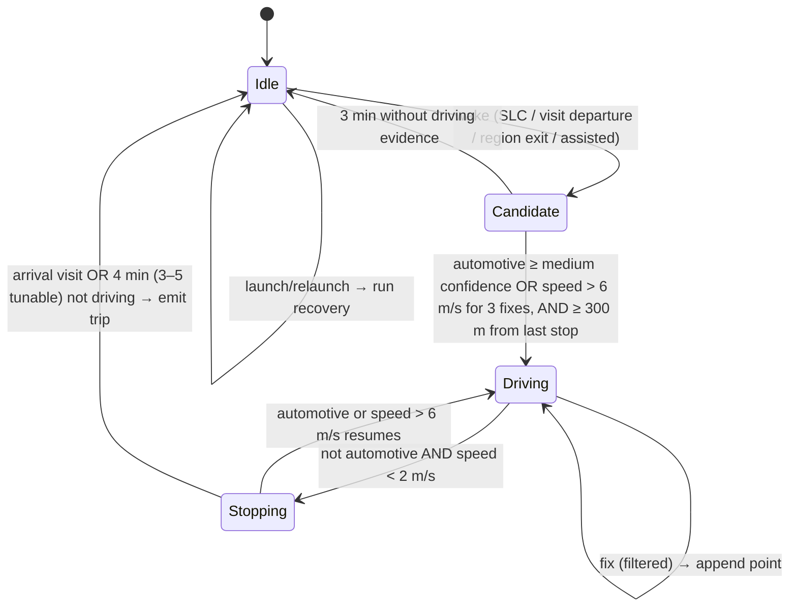

# 3. Core Location tracking strategy, background execution and battery

Statements marked **(verify)** are behaviour Apple doesn't fully document or that has changed between iOS versions. They are hypotheses for the detection test run to confirm on physical devices, not facts to build on blindly. Nothing here is claimed from simulator testing.

## 3.1 Strategy in one paragraph

Keep a **cheap, always-on wake layer** (significant-location-change + visit monitoring) that iOS keeps running even when Mile Log is suspended or terminated. When it wakes the app, **confirm driving** with Core Motion and speed, then switch to **live GPS only for the duration of the trip**, and drop back to the wake layer as soon as the trip ends. Anything the live layer missed is **rebuilt afterwards from Core Motion's 7-day activity history and visits**, shown as *recovered, unconfirmed*, and never counted until the user confirms it. This is council decision D2/D3, unchanged.

Continuous high-frequency GPS is rejected: roughly 10–15% battery per hour of use, and iOS will still suspend or kill it.

## 3.2 Layers

| Layer | API | Runs when | Cost | Role |
|---|---|---|---|---|
| Wake: SLC | `startMonitoringSignificantLocationChanges()` | always (needs Always) | very low (cell/Wi-Fi) | wakes or relaunches the app after ~500 m+ of movement, typically 1–5 min into a drive **(verify latency)** |
| Wake: visits | `startMonitoringVisits()` | always | very low | arrival/departure at places; departure time gives a better trip start |
| Wake: last-stop region | `CLMonitor` circular condition, ~150 m around the last stop | A/B tested (D2) | low | faster wake on departure; kept only if it improves start latency, given reports of missed CLMonitor events on iOS 18 **(verify)** |
| Confirm | `CMMotionActivityManager` live updates + GPS speed | after a wake, up to 3 min | low | separates driving from walking, cycling, train **(verify train/bus)** |
| Live | `CLLocationUpdate.liveUpdates(.automotiveNavigation)` inside `CLBackgroundActivitySession` + `CLServiceSession(authorization: .always)` | trip in progress only | high, bounded by trip length | the route and the distance |
| Recovery | `CMMotionActivityManager.queryActivityStarting(from:to:)` (7 days), visits | every launch and wake | negligible | finds drives the live layer missed |
| Assisted (optional) | Shortcuts automation on CarPlay / car Bluetooth connect → App Intent "Start trip" | user-configured | — | near-zero start latency for users who want it (D2) |

Background mode: `UIBackgroundModes: location`. `allowsBackgroundLocationUpdates = true` only while live; `showsBackgroundLocationIndicator = true` (honest, and it keeps the session alive).

## 3.3 Trip state machine (TripDetection package)

The state machine is a **pure Swift package**: it takes events in and emits effects out, with no Core Location imports. That makes every rule replay-testable from recorded drives.

Events in: `locationFix`, `motion`, `visit`, `regionExit`, `timerFired`, `relaunched`, `authorizationChanged`, `assistedStart/Stop`.
Effects out: `startLive(accuracy)`, `stopLive`, `setStopRegion(centre, radius)`, `scheduleTimer`, `persist(state)`, `appendPoint`, `emitTrip(segment)`, `notify(reason)`.

Rules:
- **Traffic and lights:** `automotive` + `stationary` together means still driving; Stopping only starts when automotive drops out.
- **Fix filter:** discard `horizontalAccuracy > 65 m`, fixes older than 10 s, and implied speeds over 70 m/s.
- **Start point:** the trip starts at the visit departure or the last stop's location, not at the first live fix. The gap between them is measured with `MKDirections` driving distance and flagged `estimatedStartMetres`. This matters most for the ±2% distance target, because SLC wakes late **(verify the size of this gap in the test run)**.
- **GPS gaps (tunnels, urban canyons):** under 2 minutes with plausible speed, join the fixes in a straight line. Longer gaps get a road distance between the fixes via `MKDirections`, flagged as estimated. Never invent distance with no fixes on both sides.
- **Persist at every transition.** After a background relaunch, the first thing the app does is restore state and recreate the `CLBackgroundActivitySession`/`CLServiceSession`. Apple's forum guidance says the session must be recreated straight after relaunch (verified fact in the plan).
- **Dedupe:** a recovered interval that overlaps a detected trip by more than 50% is dropped.
- **Short trips:** trips under 0.3 miles are discarded; trips under 2 miles are kept and reported separately in the test metrics (plan).

## 3.4 Expected behaviour in hostile conditions

| Condition | Expected behaviour | Mitigation |
|---|---|---|
| **User force-quits the app** | Apple documents SLC and region monitoring relaunching a *terminated* app. Whether this happens after a *user* force-quit has varied by iOS version **(verify on iOS 18 and 26)**. Worst case: no live tracking until the next launch. | Recovery rebuilds the missed drives from motion history (up to 7 days), as unconfirmed with no distance unless points exist. Onboarding and a one-off tip say "don't swipe Mile Log away". Detect likely force-quits (no clean background-to-terminate marker) and nudge. |
| **Permission downgraded** to While Using, or Precise Location off | Background detection stops; with approximate location only, distances are unusable. | Check on every launch and in `locationManagerDidChangeAuthorization` (D2). Show a local notification, a dashboard banner and a one-tap path to Settings. `requestTemporaryFullAccuracyAuthorization` for a single trip. Recovered trips need the user to enter miles. |
| **Location Services off / app permission revoked** | Nothing is tracked. | Same banner. Manual trip entry still works. |
| **Device restarts** | The wake layer should resume after the first unlock **(verify, including whether SLC is delivered before first unlock)**. | Store files use `NSFileProtectionCompleteUntilFirstUserAuthentication`, so a relaunch after unlock can write. Before first unlock, buffer to an unprotected scratch file holding no coordinates (timestamps and motion only). |
| **No connectivity** | Tracking is unaffected: GPS needs no data, and SLC uses cell/Wi-Fi radio, not internet. | Reverse geocoding and `MKDirections` estimates are queued and retried. The trip is stored immediately with coordinates only. |
| **App suspended** | During a trip, the live session keeps it running. Otherwise the wake layer relaunches it on movement. | — |
| **Poor GPS** | Low-accuracy fixes are dropped; gaps are handled as above. | The trip is flagged as "estimated" in the UI and export. |
| **Low Power Mode** | SLC and visits continue. Live updates may be throttled **(verify)**. | Report Low Power Mode share in the battery metrics. |
| **Passenger, bus, train** | Detected as driving: Core Motion can't tell driver from passenger. | Never auto-classified. Passenger trips default to Not work (plan). Saved-place rules only apply to trips the user drove. |
| **Two phones, one car** | Each phone logs the trip. | Per-device data; no cross-device dedupe needed. |

## 3.5 Battery strategy

Target: **under 5% of battery per day** for a typical day of 1–2 hours' driving (council D5).

1. Spend battery only while driving. The wake layer is close to free. Live GPS stops within 4 minutes of the trip ending.
2. Use `.automotiveNavigation` with no distance filter tighter than ~10 m; don't use `kCLLocationAccuracyBestForNavigation` unless the phone is charging.
3. The Candidate state uses reduced accuracy (`.hundredMeters`) for its first minute, until driving is confirmed.
4. No background networking during trips. Geocoding happens once per trip end, then is cached per Place.
5. Measure with the D5 protocol (same phones, 7 days with Mile Log and 7 without, Settings → Battery plus MetricKit `MXLocationActivityMetric` and `MXCPUMetric`).
6. Ship a kill-switch in the rates/config file (`detection.mode = conservative`) so live accuracy can be lowered without an app update if real-world drain is high.

## 3.6 Testing the tracker

| Level | What | How |
|---|---|---|
| Unit (Linux CI) | Every transition and rule in 3.3 | Synthetic event streams |
| Replay (Linux CI) | Real drives | The debug timeline (D8) exports JSON-lines traces; anonymised traces become golden fixtures (short, long, motorway, town, tunnel, traffic jam, passenger, train, 5/6 April midnight) |
| Device | Background, relaunch, force-quit, restart, permission changes, Low Power Mode | Scripted checklist per tester device in the detection test run |
| Field | Recall, distance error, false trips, battery | The plan's run: 8 testers, ≥200 drives, ≥21 days, against odometer photos |

The simulator's location simulation is used only for UI work and never counts as evidence of tracking reliability.
